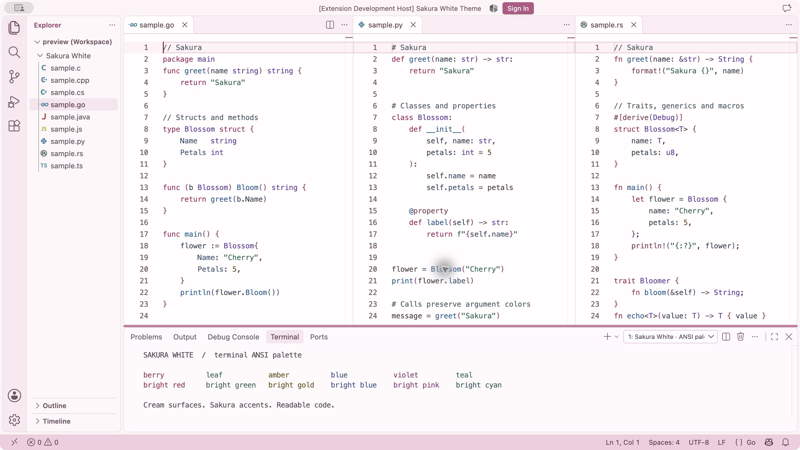
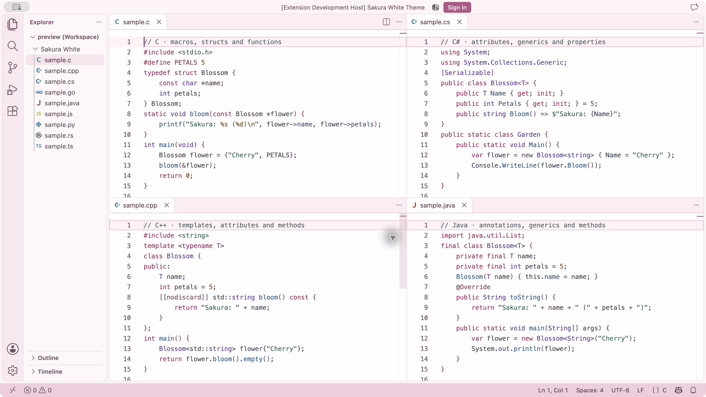
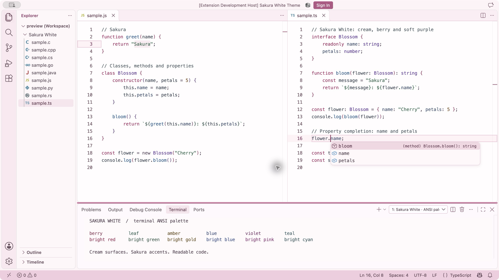

# Sakura White Theme

[简体中文](README.zh-CN.md)

A standalone light theme for VS Code: cream white surfaces, pale sakura pink selections, berry keywords and iris-purple types. Version **0.1.0** supports VS Code **1.85.0+** on macOS, Windows and Linux.

## Preview

Real VS Code captures with Sakura Contrast syntax colors. The cream and sakura-pink UI stays soft; berry keywords, iris types, blue functions, leaf-green strings and copper numbers give code distinct roles.



C, C++, C# and Java: macros, attributes, annotations, generics and properties.



JavaScript and TypeScript: selection, cursor and real property completion.



[Palette, capture details and grammar limits](docs/SAKURA-CONTRAST.md). Screenshots are repository documentation assets and stay outside the VSIX. The supplied PNG icon is included in the extension.

## Install

Build or obtain `sakura-white-theme-0.1.0.vsix`, run **Extensions: Install from VSIX…**, then **Preferences: Color Theme → Sakura White**. You can also run:

```sh
code --install-extension sakura-white-theme-0.1.0.vsix
```

This project has not been published to the Marketplace. The manifest publisher is the repository owner's GitHub handle; Marketplace publisher ownership must be confirmed before any future publication.

## What is included

- 319 explicit workbench colors covering editors, tabs, sidebars, menus, notifications, quick input, terminal ANSI colors, diff, peek, debug, settings and notebooks.
- 31 TextMate rules and 26 semantic rules, with semantic highlighting enabled.
- Language grammar checks for Go, Python, Rust, C, C++, C#, Java, JavaScript, TypeScript, JSON, YAML, HTML, CSS, Markdown and Shell (136 token assertions).
- Declarative theme data only. No activation code, runtime dependencies, layout or font changes. File icons remain your choice.

The palette was adapted from the supplied Profile's overrides for **Ayu Light Bordered**, rather than copying Ayu's theme file. Missing UI colors were authored independently. VS Code supplies its standard light defaults for any unlisted color IDs, including IDs added by future versions or other extensions. Ayu and Catppuccin are not required.

TextMate supplies syntax coloring; language servers can overlay semantic colors when available. This extension does not install language servers. Text colors were adjusted for WCAG 2 AA normal-text contrast (4.5:1) across the tested surfaces. Decorative borders, whitespace markers and shadows intentionally remain subtle. Terminal applications and user overrides can change the rendered colors.

## Develop and verify

Node.js 22+ and npm are required. Development dependencies are locked; none ship in the extension.

```sh
npm ci --ignore-scripts
npm test
npm run test:grammar
npm run package
npm run check:package
npm run test:integration
```

Grammar and integration tests download VS Code stable by default. Set `VSCODE_EXECUTABLE_PATH` to an installed executable to test it instead, or `VSCODE_VERSION=1.85.0` to select the minimum version. Linux integration tests need a display, for example `xvfb-run -a npm run test:integration`. Integration testing uses temporary user data, extensions and workspace directories; it never changes your normal VS Code settings.

`dist/contrast-report.json`, `dist/grammar-report.json` and `dist/package-report.json` are generated locally. `dist/` and VSIX files are excluded from Git; CI uploads the VSIX and reports as build artifacts.

Optional read-only Profile analysis (never needed to build):

```sh
node scripts/analyze-profile.mjs /path/to/Frontend-Sakura.code-profile
```

See [conversion and privacy](docs/CONVERSION.md), [actual verification](docs/VERIFICATION.md) and [third-party notices](THIRD_PARTY_NOTICES.md). MIT licensed.
