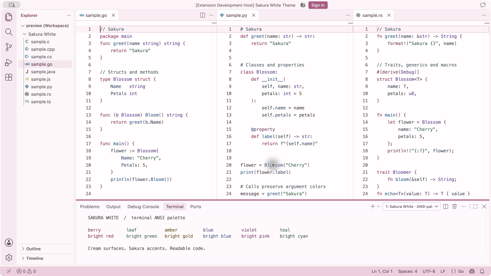
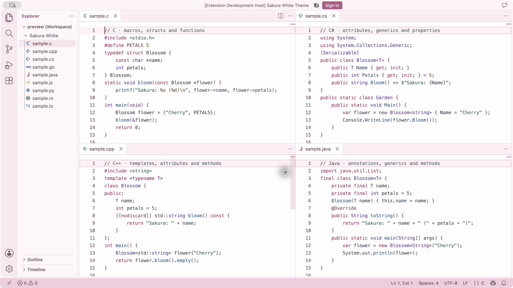
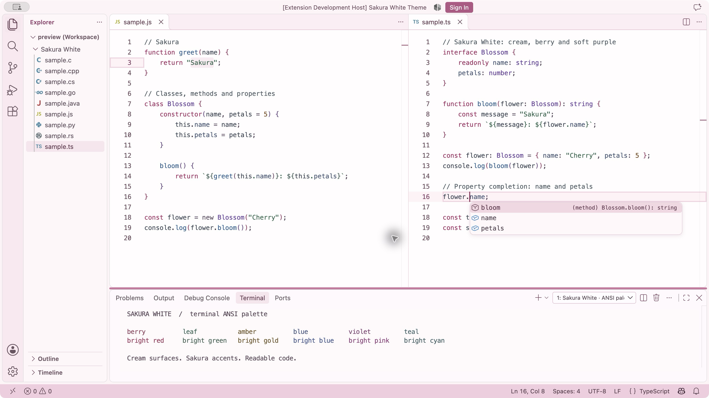

# Sakura White Theme

[English](README.md)

独立的 VS Code 浅色主题，以奶油白、浅樱粉、莓果粉和柔和紫色为主。当前版本 **0.1.0**，支持 VS Code **1.85.0 及以上**，适用于 macOS、Windows 和 Linux。

## 主题预览

以下均为真实 VS Code 截图。Sakura Contrast 保留奶油白与樱粉界面，以莓果红关键词、鸢尾紫类型、深蓝函数、樱叶绿字符串和铜棕数字建立清晰的语法层次。



C、C++、C# 与 Java：展示宏、属性、注解、泛型和字段。



JavaScript 与 TypeScript：展示选区、光标与真实属性补全。



详见[配色、截图来源与语法限制](docs/SAKURA-CONTRAST.md)。预览图作为仓库文档资源，不进入 VSIX；提供的 PNG 图标会随扩展打包。

## 安装

获得或构建 `sakura-white-theme-0.1.0.vsix` 后，执行命令 **Extensions: Install from VSIX…**，再通过 **Preferences: Color Theme** 选择 **Sakura White**。也可以使用：

```sh
code --install-extension sakura-white-theme-0.1.0.vsix
```

本项目尚未发布到 Marketplace。清单中的 publisher 使用仓库所有者的 GitHub 名称，未来发布前仍需确认 Marketplace publisher 的注册和所有权。

## 功能

- 319 个 UI 颜色，覆盖编辑器、侧栏、标签页、菜单、通知、快速输入、终端 ANSI、差异、预览、调试、设置和笔记本界面。
- 31 条 TextMate 规则、26 条 Semantic Token 规则，开启语义高亮。
- 针对 Go、Python、Rust、C、C++、C#、Java、JavaScript / TypeScript、JSON / YAML、HTML / CSS、Markdown、Shell 进行真实语法检查，共 136 个 token 断言。
- 仅声明式主题数据，无运行时代码和运行时依赖，不调整布局、字体或文件图标。

主题从原 Profile 的 Ayu Light Bordered 覆盖配置转换而来，没有复制 Ayu 主题文件。缺失的 UI 颜色另行编写，未列出的颜色使用 VS Code 的标准浅色默认值，包括未来版本或其他扩展新增的颜色 ID。无需安装 Ayu 或 Catppuccin。

TextMate 提供基础高亮，语言服务可在其上应用语义颜色。主题不安装语言服务器。文字颜色已按测试背景调整到 WCAG 2 AA 普通文字 4.5:1 对比度；装饰边框、空白标记和阴影保持柔和。终端程序或用户覆盖仍可改变显示结果。

## 开发与验证

需要 Node.js 22+、npm。开发依赖由 lockfile 锁定，均不随扩展分发。

```sh
npm ci --ignore-scripts
npm test
npm run test:grammar
npm run package
npm run check:package
npm run test:integration
```

语法和集成测试默认下载 VS Code stable；可通过 `VSCODE_EXECUTABLE_PATH` 指定已有可执行文件，或通过 `VSCODE_VERSION=1.85.0` 测试最低版本。Linux 集成测试需要显示环境，例如 `xvfb-run -a npm run test:integration`。测试使用临时用户目录、扩展目录和工作区，不修改正常 VS Code 配置。

本地生成报告位于 `dist/`，该目录及 VSIX 不进入 Git。CI 将 VSIX 和报告作为构建产物提供。

可选的只读 Profile 分析命令：

```sh
node scripts/analyze-profile.mjs /path/to/Frontend-Sakura.code-profile
```

详见[转换与隐私说明](docs/CONVERSION.md)、[实际验证记录](docs/VERIFICATION.md)、[第三方许可说明](THIRD_PARTY_NOTICES.md)。本项目采用 MIT 许可证。
